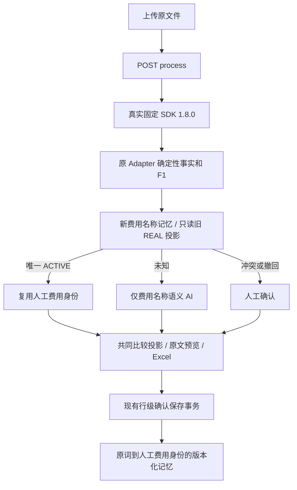

# SIMPLIFY_CORE_LEARNING_FLOW_R1_REPORT

项目：`/Users/kyoen/Projects/sanzo-cost-table`；案件：No.202608310011。执行：2026-09-13 UTC／2026-09-14 JST。

**阶段 SUCCESS：限定真实SDK核心Demo两轮通过。项目整体仍PARTIAL（本番／任意客户布局未验收；旧W0及封存历史状态不改写）。**

本轮依据最新附件实施，替代上一轮“严格只读”限制；允许命名彩排案件、现有事务写入与固定授权AI。没有新系统、数据库、SDK源码调查、额度调整或commit/push。

## 1. 修改前真实流程

普通上传 → `/field-sources` SDK预读 → 自动「会社・適用範囲を原文から確認」 → 用户选择公司/运输范围 → `/process`再次读取 → 完整context记忆 → 未知名称AI → 比较／确认。旧运行实例只读截图确认为10行。

## 2. 修改后真实流程

普通上传 → `/process`（`field_bindings={}`）→ REAL SDK → 原Adapter/F1确定性事实 → fee-name-v2查询／只读旧REAL兼容 → 仅未知名称AI → 共同比较投影 → 原行确认事务 → 版本化名称记忆。第二轮SDK新事实＋5项记忆，0AI，无公司/运输窗口。



## 3. 完全保留的骨架

FastAPI/Uvicorn原生单页、Python3.12、PG16、DocumentSdkAdapter、固定wheel1.8.0、F1、事实处理、SDK/Mock隔离、价格/来源、现有存储与事务、历史、原件预览、Excel、AI传输/schema/授权/预算/429保护均保留。`PRESERVED_BOUNDARIES.json`提供前后相同SHA；运行容器内全部36个业务源码/静态/迁移文件与当前checkout一致（确切数量以`LIVE_SOURCE_MATCH.json`为准）。

## 4. 删除的普通用户步骤

不再预读后要求每个文件确认公司、运输范围或source ID；不调用field-sources，也不加载该dialog脚本或DOM。三次真实process请求均为空field_bindings，无人工文档角色绑定。

## 5. field_review相关代码处理

`field_review.js`、`human_field_bindings.py`、可选`/field-sources`及后端绑定参数作为兼容／内部工具保留；正常`index.html`不加载其脚本、不提供角色dialog，`workflow.js`不调用预读。旧工具`rehearse_real_adapter.py`保留原样；本轮使用`tools/rehearse_fee_policy.py`，不可混用历史工具的角色步骤。

## 6. company的角色

仅可选文档metadata。没有可靠绑定则原始observation保持None，不猜公司，不作为REAL名称key。当前三文件普通处理均未确认公司；比较列用当前上传文件名，重复同名文件附文档ID区分。文件名只用于显示，不参与解析／答案查询。

## 7. transport的角色

保持可选metadata，未知保留None。它不属于fee-name-v2签名，也不会使未知名称不能分类或不能学习。未制造N/A、运输方式或HUMAN字段证据。

## 8. 新Memory key / policy

`fee-name-v2:`＋canonical JSON SHA256。签名包含policy、normalization版本、tenant、NFC/空白规范化原词，以及可靠同行equipment/billing_unit/charge_scope/extra_terms。未知条件明确为null，精确相等才复用；不是通配符。判断位于`fee_policy.signature/key`，总入口`domain.memory_key`。

## 9. 强制字段

可信REAL来源、F1完整原词、document/source/record一致、tenant、原始raw_label。保存仍须用户选定统一fee_id/名称，并通过案件/明细/记忆版本、幂等与事务检查。缺原词完整证据仍不产生自动记忆。

## 10. 可选字段

公司、transport、DOCUMENT层scope/terms不要求。费用行能可靠提供的equipment/billing_unit/charge_scope/extra_terms用于精确区分；只接受完整原值、同行record与LINE范围。已知费用条件相冲突不合并；未知并不匹配某个已知值的记忆。金额、币种、case/file/日期不进入名称签名。

## 11. Legacy兼容

新key优先；没有新slot时，仅投影同tenant、origin=REAL_SDK、具有人工correction事件证明的旧key当前版本。所有候选均ACTIVE且fee_id唯一才自动复用。任何撤回、冲突或不同fee都需人工确认，不交AI仲裁。Mock与其他旧来源排除。

旧key、版本、案件均只读。新人工保存追加新policy v1；读时的legacy证据版本与新key待写版本0分开。导入外键保存**实际匹配的旧key/版本**。对legacy撤回可创建新policy撤回shadow，后续查询新slot优先；旧ACTIVE历史记录保留但不会越过shadow。默认参考RevokeCommand仍要求正版本，只有服务在实际验证legacy投影后接纳尚未生成新slot的版本0。

## 12. Conflict处理

沿用ACTIVE／CONFLICTED／REVOKED状态与显式replace语义。不同人工fee产生冲突；普通确认不能自动解除既有冲突／撤回，需详情中的明确重新确认。先查记忆，冲突／撤回项不进入AI。事务失败、并发版本、请求幂等测试通过。

## 13. 20FT / 40FT区分

原词保留，可靠同行equipment进入签名和比较区分条件。测试用相同raw_label分别20FT／40FT／unknown证明key不同；真实比较海上20与40各为一行。比较允许双方已知条件无冲突且候选唯一时暂定合并，记忆仍精确条件匹配。

## 14. 金额为什么不会继承

`DocumentSdkAdapter → structure_facts`产生本次事实；memory只返回fee身份。新memory的context_json/source_ref不复制raw_value/currency/amount/unit_price单元格，保留原词/费用条件的源引用及人工事件ID。全部原始证据仍在不可改写的item/task/correction历史里。旧v1保存过的完整source证据不删除、不回写；新policy已避免复制其中的价格字段。

第二轮目标：item `b3f9fe65-9e31-4b97-b544-3c7e1b62cbc8`；SDK原词来源`見積明細!B16`，金额`見積明細!F16`原值`9500`，币种`E16`原值JPY；这些是实际读取结果，非Adapter常量。匹配key `fee-name-v2:d3f63c8153bb222bb898ed1acf07e6b404d20a97f8c7601bbe50a1f3f08f06a4` v1，learning_event `1cbe4d89-701c-42fe-9bf0-0a7fce6df376`；人工fee_id `8561aeb3-2f15-4eb9-b8ee-0b0e70a46466`。详见`DELIVERY_PRICE_AND_MEMORY_PROOF.json`及原始公开API JSON。

## 15. 第一轮实际AI调用

案件 `630352ab-f748-4f08-b7fb-b1af7f10e259`，Excel①＋PDF②；SDK公开调用4次。A的5条**已存在真实人工旧记忆**，本轮只读legacy命中，未清理或强造MISS。B的5条未知原词合成1个真实分类请求，未传A已命中项。

| 原词 | 查询结果 | AI请求 | 命中类型 |
|---|---|---|---|
| O/F 20' | MEMORY_APPLIED | 0 | LEGACY_PROJECTION |
| O/F 40' | MEMORY_APPLIED | 0 | LEGACY_PROJECTION |
| DOC FEE | MEMORY_APPLIED | 0 | LEGACY_PROJECTION |
| 通関手数料 | MEMORY_APPLIED | 0 | LEGACY_PROJECTION |
| 配送手数料 | MEMORY_APPLIED | 0 | LEGACY_PROJECTION |
| OCEAN FREIGHT 20' | AI_REQUIRED | 分类batch1 | — |
| OCEAN FREIGHT 40' | AI_REQUIRED | 分类batch1 | — |
| DOCUMENTATION FEE | AI_REQUIRED | 分类batch1 | — |
| CUSTOMS CLEARANCE | AI_REQUIRED | 分类batch1 | — |
| DELIVERY CHARGE | AI_REQUIRED | 分类batch1 | — |

唯一实际调用：request_id `req_c3c2198cc7a5413c87c4db17f3309c60`；请求／实际模型均`gpt-5.6-terra`；HTTP200；input923/output202/total1125 tokens；累计attempt48；无自动重试。没有金额/币种/source/file二进制进入语义分类输入，响应schema不允许这些字段。实际账单金额未提供，不估算费用。

冷启动“配送手数料未知→AI→人工配送費”另以真SDK＋隔离PG＋明确离线分类器验证，不能误称为本轮线上A发生了AI调用。真实未知AI证据来自B5项。

## 16. 第二轮实际AI调用

案件 `8b9daf16-503a-4ddf-b933-81c6a8e1edb6`，只上传Excel③；在首轮服务重启后执行。SDK公开调用3次；5项DIRECT命中，classification=0，quotation_extraction=0，AI总数=0。第二轮无人工改名或预填金额。

## 17. 第二轮是否真正0AI

是。真实任务请求列表为空、5个skipped IDs/对应memory事件、持久累计计数48→48互相一致；原授权ID未变。另在隔离PG用`extractor=None`、`pause_ai=True`与新连接证明无Key/AI暂停不会阻塞全命中文件。本轮没有故意制造真实账号错误，也未取消后台实际凭据。

## 18. 第一轮最终比较行数

5行。5次现有行级保存按钮，对10个成员实际写入10条人工确认/新policy记忆。网页和Excel使用同一个projection。

| 統一費目 | Excel① | PDF② |
|---|---|---|
| 海上運賃（20FT） | 1200 USD | 1150.00 USD |
| 海上運賃（40FT） | 1900 USD | 1850.00 USD |
| 書類作成手数料 | 8000 JPY | 7500.00 JPY |
| 通関手数料 | 12000 JPY | 11500.00 JPY |
| 配送費 | 8000 JPY | 9000.00 JPY |

价格精度保留SDK输入，例如PDF `.00`；没有四舍五入或编辑。

## 19. B PDF company unknown能否学习

可以。5项公司/transport仍None，F1旧source_ready不被改True；它们的完整费用原词与同行来源可靠，人工确认后5个新REAL名称slot均ACTIVE。不伪造全PDF验证、bbox或未提取的条件。

## 20. 技术UI隐藏情况

连接装配／累计预算、SDK限制／issue代码、AI提取/分类次数移入默认关闭的「詳細を見る」。普通主流程无角色窗口；原确认弹窗保持两张短原文/当前价格卡、一个名称输入、保存。高级竞争/撤回在详情中保留。截图及26项只读live验证通过，1366×768下确认框可完整显示；价格列无AI状态和操作控件。

## 21. 实际修改文件

- `README.md`
- `backend/sanzo_core/demo_store.py`
- `backend/sanzo_core/domain.py`
- `backend/sanzo_core/ingestion_store.py`
- `backend/sanzo_core/postgres.py`
- `backend/sanzo_core/service.py`
- `backend/sanzo_demo/app.py`
- `backend/sanzo_demo/comparison.py`
- `backend/sanzo_demo/export.py`
- `backend/sanzo_demo/ingestion.py`
- `backend/sanzo_demo/row_confirmation.py`
- `backend/sanzo_demo/static/app.js`
- `backend/sanzo_demo/static/index.html`
- `backend/sanzo_demo/static/workflow.js`
- `tests/test_demo_mock_isolation.py`
- `tests/test_demo_real_adapter.py`
- `tests/test_demo_real_sdk_pipeline.py`

## 22. 实际新增文件

- `backend/sanzo_core/fee_policy.py`
- `tests/test_demo_fee_policy.py`
- `tools/rehearse_fee_policy.py`
- `docs/SIMPLIFY_CORE_LEARNING_FLOW_R1_REPORT.md`

源码全文与patch基于起始未跟踪快照，不依赖空git diff；精确最终SHA见`END_BASELINE.json`和`CHANGED_PATHS.json`。

## 23. DB schema是否变化

无本轮schema修改；18张表集合未变，旧记录行哈希全部保留（唯一预期变化是授权行requests_used增加1）。案件33→35、文档54→57、items152→167、memory_slots14→24、memory_versions21→31、correction_events36→46，fees12→12。`DB_PRESERVATION.json`列出每表证据。

起始记录的是迁移源码SHA、schema_migrations行指纹和表集合／行指纹，并未单独抓取原始DDL快照；不补造起始DDL哈希。最终只读抓取columns/constraints到`DB_SCHEMA_FINAL.json`。schema不变结论结合零DDL代码变化、6条相同迁移记录和原字段/约束正常回归。

## 24. Migration是否变化

0新增、0修改。6条已应用迁移SHA及schema_migrations整表指纹完全相同。沿用原PostgreSQL、命名卷和事务；没清库、迁移其他项目或删除既有数据。

## 25. AI预算before/after

固定`sanzo-three-file-mock-sdk-v1`，gpt-5.6-terra，max100不变；47→48，只增加这次B分类1次。所有旧47条账本记录完整保留。首轮重启后仍48，第二轮仍48。

## 26. 回归、失败复测及未解决事项

最终344项应用/领域/PG测试PASS，0skip（含309 Demo与15个新增费用policy测试）；参考46项、契约8项PASS。另一次本机领域15项为同套复测，不能重复计为独立覆盖。真实首轮97个检查，重启续跑118个检查，最终只读UI26个检查（跨阶段包含重复核对，不作为准确率指标）。

所有失败保留：首轮legacy外键缺陷已修；默认撤回命令兼容已修；2个已废弃公司必填SDK断言、1个PDF确认不可学断言调整到本轮新契约，Mock隔离测试更新REAL侧完整来源fixture与key期望，Mock自身规则未放宽。测试内tuple修改／LINE scope误判修正；全套runner缺contracts mount、浏览器resume误用初始状态、只读UI未打开嵌套详情均为验证工具问题，修工具后复测通过。详见`FAILURES_AND_RERUNS.json`和未改写原日志。

已知边界：PDF无可靠bbox时只做页级预览；OCR未执行；公司/transport和无法拆分的文档信息继续unknown；SDK局部limitations及EXTRACTION_UNRESOLVED证据保留在任务/详情/Excel附表，完成任务内部仍可标REVIEW_REQUIRED，名称学习不再受文档metadata完整性阻塞。任意客户布局/客户正式导入格式未验收。费用关键条件不同或歧义仍需确认。

未执行：SDK开发仓库访问/修改/测试、全量语料、云OCR、报价事实AI、模型切换、预算增加/清零、生产化功能、真实客户文件处理、commit/push/merge/tag。旧AS-IS及W0状态原样封存。没有通过改文件或fixture制造成功。

## 27. Demo是否满足最终核心流程

**本轮限定目标满足。** 实际文件读取→记忆优先→仅未知AI→现有简单行确认保存→重启→第二案件全命中0AI＋新价格／旧案保护／预览／Excel一致。首次A命中旧REAL历史的事实明确记录，没有强制清空后重做“首次”。

启动（项目目录下，一条命令；沿用已配置本机后端安全凭据）：

```sh
.demo-runtime/sdk-business-r1/.venv/bin/python tools/start_real_demo.py
```

URL：`http://127.0.0.1:8765`。当前服务已运行最终源码；启动读取指定后端凭据但不输出、不打包。Python3.12.13／SDK1.8.0／PG16。branch=`main`，HEAD不存在（尚无首次提交，rev-parse退出128），不是阻塞；未commit/push。

截图见`browser_round1/`、`browser_round2_retry01/`、`saved_ui_retry01/`；旧界面对比见`browser_before/`。生成ReviewBundle后停止等待ChatGPT独立レビュー。
